# Firelight

**Survive one night in a dark room. Keep the fire alive, eat, and be careful what you let in.**

A short horror-survival game in chunky pixel art. One night lasts about seven minutes and gets worse every hour; a run is up to three nights, the third in a blizzard. Most first nights end in death; each death screen tells you what killed you and gives a hint. Only a night survived to dawn scores, mostly for how you got through it.

**Play:** https://firelight-topaz.vercel.app (desktop browser with keyboard or mouse, or a phone held sideways)


## How to play

| Key | Action |
| --- | --- |
| S | Stoke the fire (1 wood) |
| E | Eat: cooked meat if you have it, raw if that's all you have (raw fills you less and makes you sick). 1.5 s cooldown |
| X | Douse a blaze with blood (2 blood) |
| N | Music on or off |
| C | Cook up to 3 raw meat. It finishes on its own in about 6 s, as long as the fire is lit |
| G | Go out for wood (short trip) |
| F / Space | Burn her claws (1 wood, needs a fire), or slam the cellar hatch from night 2 |
| R | Run back from a trip |
| B | Build |
| 1–9 | Dialogue choices |
| J | Journal (everything you've heard tonight) |
| M | Sound (also on the title screen; the game goes silent while the tab is in the background) |
| Esc | Menu, which pauses |

## What can kill you

Every threat has a tell and a counter. Threats arrive as the night goes on.

| From | Threat | The tell | What saves you | Death |
| --- | --- | --- | --- | --- |
| 10 pm | **The dark** | Slitted eyes open around the room, a heartbeat starts, red creeps in from the edges. Once the fire is out you have **about ten seconds** | Keep the fire above smoldering. It burns down faster every hour | The dark comes in |
| 10 pm | **Hunger** | A stomach growl at "hungry"; at "starving" it repeats and a dull red border closes in. **Meat goes bad**: raw in two minutes, cooked in four, and its count turns green when something is about to turn | Keep eating, which means traps early: at night they're the only meat, checked on every wood trip. Cook raw meat first; raw makes you sick. Salt-cured meat keeps | You starve |
| 11 pm | **The thing in the trees** | A howl, and its amber eyes shining in the treeline outside the window. While you're out and it's close, **a grin grows beneath its eyes** | One rule: once it's close, the grin fills in **four seconds**, every time. Leave while its eyes are in the treeline and you have four seconds. If it howls while you're already out, you get a moment to turn back first. Running back brings you home empty-handed | A full grin |
| midnight | **The mimic** | Real visitors' **footsteps crunch through the snow before they knock**. The mimic just knocks, word for word in the voice of someone you'd open for. There is only one stranger | Keep the door shut when nothing walked up | You opened the door. It was not a person |
| 1 am | **Her, at the window** | She rises into the window from below the sill: a gaunt black figure backlit in red, with one huge pale eye, an empty socket, a hanging jaw and wet hair. On her first visit the glass always explodes inward, boarded or not, and from then on wind and snow blow in; through a bare frame the fire burns down faster | Board the window beforehand. Her eye watches through a gap while her hand hooks a board and pulls, to a rhythm of thuds. **Burn the hand** and she snatches it back in a burst of flame and smoke. **Don't, and she tears every board off** and drags them away. You have to board the window again (8 wood) | Bare window: she climbs in, even while you're out, and **takes ten logs** through the frame; you can't burn her back. **Fewer than ten, and she takes you.** You can still nail boards up in the last seconds |
| any time | **The fire itself** | The wood pile leans toward the fire when it's over 25 logs | Keep the pile at or under 25, or build a woodshed. If it topples, logs crash into the fire and it roars toward the roof: **douse it with 2 blood** in time | The cabin burns down |
| 3 am | **The walkers** | Some mimics have learned to fake footsteps. Nothing in the text or sound gives them away | A lit **blood lantern** shows the shadows of feet under the door. **People stand on two feet. A mimic gets it wrong: one foot, or three.** The words are the same either way, so count | You opened the door |
| night 3 | **The cold** | The blizzard. A cold meter beside hunger (warm, chilled, cold, freezing); at "freezing" a white-blue frost border closes in | Outside you chill fast: **one blizzard trip takes you most of the way** (two-thirds of the meter, half with a fur coat), so two in a row will kill you. Being cold costs you too: from "cold" your hands are slow (stoking takes longer), trips take longer, and from halfway you burn through food faster. A strong fire warms you back up, about 3 points a second roaring and barely at all smoldering. A broken, bare window lets the cold in | You freeze |

**The door never opens by itself.** Every knock asks you: open it, or keep it shut. Opening for the right people matters:
- **The stranger** knocks first. Let her in and she teaches you the rules. She hasn't eaten in days, so she needs cooked meat once: she begs three times, and **the third plea is the one that counts**. Feed her earlier and she'll be starving again before dawn. Feed her raw meat and it kills her. If she starves, something starts moving under her skin. Drag her body out into the snow, which is a risky trip, and the smell keeps the hunter close for the rest of the night. Or leave her, and it gets up. Turn her away at the start and none of this happens. You can always tell her to leave when she asks for food.
- **Some nights she isn't the stranger** (about 1 in 8 of the nights you let her in). The tells: her eyes catch the firelight red; she sits too still and never shivers; she never warns you of anything; and she doesn't ask, she demands ("Feed me."). She eats raw meat and smiles. Feeding her holds her off, but the demands come faster and angrier toward dawn. Refuse her twice and she kills you. Keep her until first light and she stops pretending. The only way out is to tell her to leave.
- **The woodcutter** (from 11 pm, up to three times a night) mostly sells wood: 1 meat for 7 logs or 2 meat for 15, and at a push 6 logs for 1 cooked meat. On the blizzard night his wood is dry.
- **The trader** comes some nights, once, from midnight (see below).

That's everyone. Knocks are rare, and nobody but the stranger stays: most knocks late in the night are mimics. Each real person you let in is worth 10 points at dawn.

**Familiar voices.** The mimic copies whoever you'd open for, word for word, even how they greet you once you've let them in before ("It's me. The woodcutter."). From night 2 it knows the trader's voice too.

**Knocks while you're out** wait at the door. You can't hear footsteps from the trees, so when you come back the snow tells you: fresh footprints leading up to the door, or none.

Keep the door shut on a real visitor and you hear their footsteps leave. Keep it shut on the mimic and the knocking stops, but no footsteps leave.

| | |
| --- | --- |
|  | 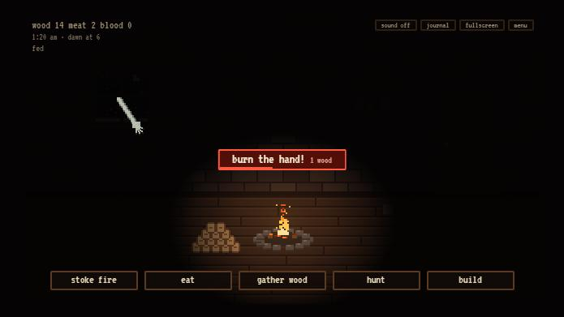 |
| 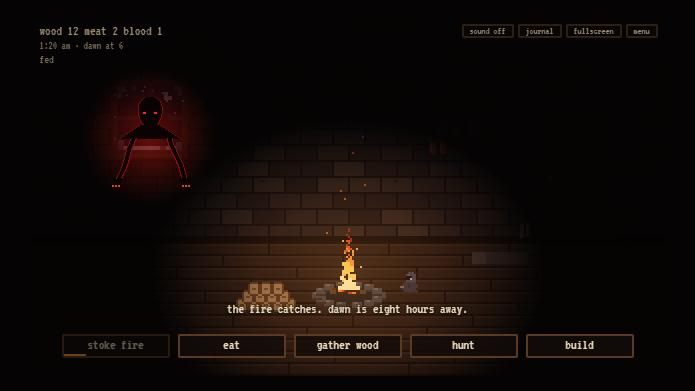 | 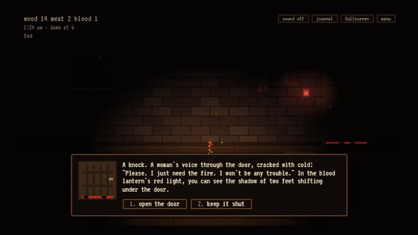 |
| 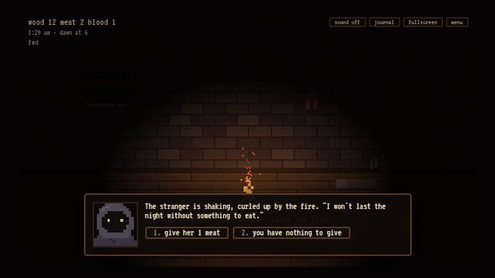 | 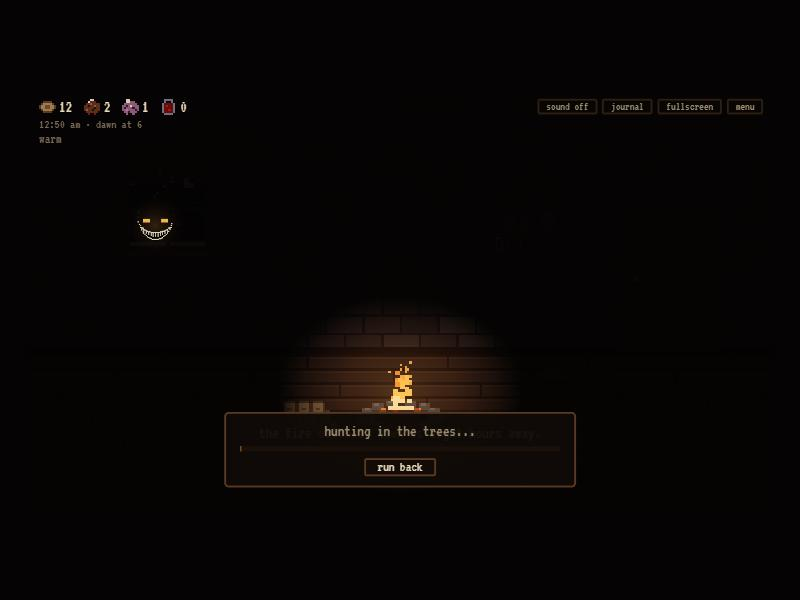 |
| 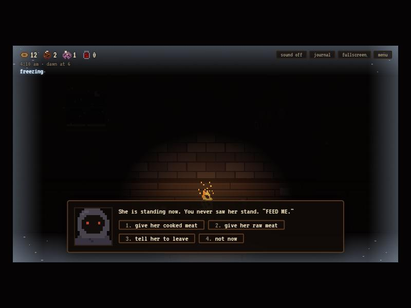 | |

## The day, and nights 2 and 3

Make it to dawn and you choose: **end here** and bank your score, or **rest through the day** and face the next night. A run is up to four nights (night 4 is a placeholder for now: the blizzard again). Longer runs score far more, and the leaderboard marks them with one ☀ per night.

**The day** is a planning screen over the daylit room. It runs from 6 am to 10 pm: 16 hours, and every choice costs some. Each button shows what time it'll be when you're done.

| Action | Hours | What it gives |
| --- | --- | --- |
| Chop wood | 2 | 9–12 wood |
| Hunt in daylight | 2 | Safe meat, sometimes blood |
| Check the traps | 1 | Two catches per trap (from night 2, sometimes fur) |
| Scavenge the empty village | 3 | **Salt**, sometimes blood, sometimes a jar of **nails** (each board holds through one extra pull). The village tells its own story: barred doors, torn boards, tally marks that stop at two |
| Repair or board the window | 2 | Back to three boards. The glass is gone for good, so the wind is in from the start |
| Bury her | 2 | Only if you dragged the stranger's body out; it stops drawing the hunter |
| Sit with the stranger | 1 | Only if she's alive; she gives you salt and warns you about the floor |
| Sleep | 6 | Skip it and the night gets worse; see **No sleep** below. Sleeping resets the count |

The day also dries every wet log and spoils any meat that isn't cured. The day screen warns you what the next night brings.

**Night 2** keeps what you have and what is broken: resources, traps, the lantern, the boards, the broken window, and the stranger alive, gone or buried. Everything that hunts you behaves as if it were **two hours later**: the thing in the trees and the knocking start as soon as it's dark, she comes to the window from 11 pm, the walkers from 1 am, the fire burns faster and the mimic knocks more often. The day screen and the start of night 2 both warn you.

| New on night 2 | |
| --- | --- |
| **Salt** | *Salt the doorway* (2 salt): the next thing you open the door to that isn't a person can't cross; the line breaks instead of you. *Salt the sill* (2 salt): the next time she would get through the window, she recoils |
| **The thing under the floor** | There is a cellar hatch in the room. The floorboards creak and dust puffs up, then the lid lifts and pale fingers curl out, with eyes in the gap. It sits right under the meat rack. **Slam the hatch** (F/Space). **Bar it** with a beam (4 wood): slam it in time and the beam stays whole; miss, and the beam breaks instead of it getting out. With no beam, a long pale arm comes up the wall and strips **half your meat** off the rack, then stays down a long while. No meat, and it takes **the stranger**: one sharp breath and she's gone. No stranger, and it takes you. While you're out, nobody is there to slam it |
| **Fur** | From night 2, traps now and then catch a pelt. Fur makes a coat or insulation, or keep it: 3 points each at dawn |

**No sleep.** Each day in a row you skip sleep makes the next night worse:

| Days awake | What happens |
| --- | --- |
| 1 | Your eyes close every 15–20 seconds or so for 2–3 seconds; you can't act while they're shut. Slower hands and trips, and you get hungry faster. **Meat cooking while your eyes are shut burns**: it goes on the fire instead, which burns a little longer for it |
| 2 | Longer, more frequent dozes, and **things that aren't there**: knocks with footsteps but nothing under the door (the lantern shows no feet at all); howls with no eyes in the treeline; whispering at the edge of hearing; her at the window when she isn't (look closely: a faint double of her drifts around her); the hatch rattling three times as often, only one in three real. And every mimic seems to walk up, so footsteps tell you nothing |
| 3 | Longer and more frequent still, trips take two seconds more, it howls every few seconds, its eyes and grin flicker in the treeline, and the false hers have no tell at all |
| 4 | You don't make it to the first hour |

**Night 3 is the blizzard.** Everything still comes two hours early, and:

| | |
| --- | --- |
| **The cold** | See *What can kill you*. You can't chain trips any more: go out, come back, warm up by a big fire, then go again |
| **Trips take half again as long** | Wood runs, building the shed, everything outside. The four-second grin doesn't change, so you're exposed longer. Now and then (about 1 trip in 25) you **lose the path for a moment** in the white: a gust, a thump, and a couple of extra seconds out there |
| **Wet wood** | Everything you bring in is wet (the woodcutter's isn't). Wet logs show dark and frosted on top of the pile, and the count reads e.g. "18/25 · 6 wet". They dry in about a minute by a burning fire: faster by a roaring one or the stove, much slower by a dying one. Stoking uses dry wood first; with only wet logs left the fire takes it but burns half as long, hisses and pops, and smoke collects under the roof and drifts over the top of the window. The smoke is only for show |
| **She is quicker in the cold** | Her pull on a board is about 30% faster, so there's less time to burn her back |
| **The stranger** | She knows this weather. (Her story comes in a later version) |

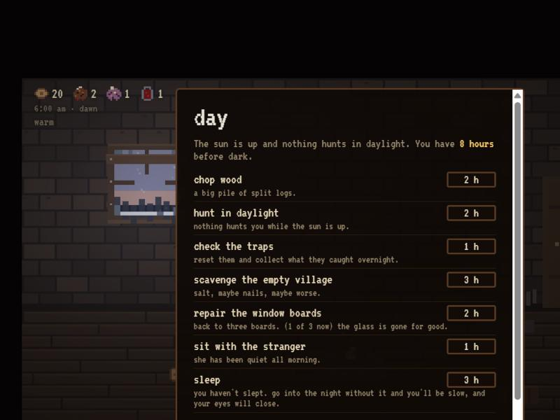
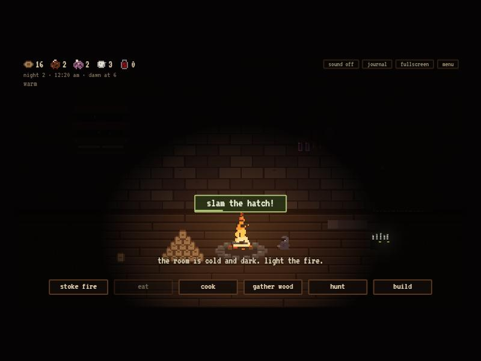

## Building

Everything you build costs something you could have kept. **Build in the room itself:** a small amber ember glows over each spot where you could build something right now:
- the window: boards, salt the sill;
- the door: salt the doorway;
- the traps by the door: another trap, or salt one;
- the lantern hook;
- the hatch;
- beside the fire: the drying rack;
- the meat rack: cure;
- the right wall: the woodshed;
- the bedroll: the fur coat;
- the walls: insulation;
- each corner: a torch.

Click an ember for a card with what it does and what it costs. The **build** button (B) still lists everything.

| Build | Cost | What it does |
| --- | --- | --- |
| Window boards | 8 wood | Three boards. Without them, her first visit at 1 am kills you. Repair one for 3 wood |
| Trap (up to 3) | 6 wood each | The only way to get meat at night (there's no hunting after dark). Raw meat and blood, collected on every trip. **Each wears out** after a few catches, and sometimes something tears one apart: a heavy iron clank and the chain dragging, and you bring the mangled bear trap back inside the door. The smell keeps the thing in the trees close for longer |
| Blood lantern | 8 wood + 4 blood | Red light under the door shows whether anything is actually standing there. That's the only way to catch the walkers after 3 am. It burns a jar of blood every minute, and goes dark when you run out |
| **Woodshed** | 25 logs, 1 s outside each | A shed against the outside wall that holds 100 more logs. **You build it a bit at a time**: each trip carries out the wood you have and builds it in log by log, and you can run back any time without losing what's built. That's also how you spend a pile that's getting too tall. Once it stands, a **small cabinet appears in the right wall** with a candle beside it: it opens straight onto the shed. Click it to look in. Wood moves on its own: extra logs go into the shed, the pile restocks from it a few logs at a time when it runs low, and the cabinet swings open while they do. The wood count shows what's in the shed |
| Corner torches (up to 4) | 2 wood each | An iron sconce in each corner of the room, where the eyes like to sit. Once you have a woodshed, its candle lights the back-right corner and that torch isn't offered (build it first and you keep both). Burns all night with a faint warm glow, and nothing opens its eyes inside it. The first time you light a corner, now and then a rat bolts out of the shadows |
| Cure meat | 1 salt | Rubs salt into 2 cooked meat so it never goes bad |
| **Drying rack** | 12 wood | Beside the fire. Dries wet wood three times faster (eight logs at a time), and **smokes cooked meat** so it never goes bad, one piece every 20 seconds while the fire burns. Smoked meat counts as cured. It keeps your salt free for the salt lines |
| Fur coat | 4 fur | You get cold outside a third more slowly |
| Insulate the walls | 6 fur | The house loses heat more slowly and the fire warms you a little faster. (Six fur is also 18 points at dawn; whether insulation is worth it is up to you) |
| Salt the doorway / the sill | 2 salt each | One use each; see night 2 |
| Salt a trap | 1 salt | A salted trap catches meat far more often, for as long as it lasts; the salt goes when the trap breaks. You can see the white flecks on it |
| Salt around the hatch (night 2) | 2 salt | One use: the next time it would get out, it touches the salt and drops back down. Spent before the beam |
| Bar the hatch (night 2) | 4 wood | A beam across the cellar hatch. Breaks instead of you the first time you miss the slam |

## The trader

Some nights (about 3 in 5), once, from midnight: slow footsteps and a clink, and a tall man in a long gray coat and a wide hat. Let him in and **he opens the coat**. His goods hang on hooks in the lining, more than should fit.

| Item | Price | What it does |
| --- | --- | --- |
| Iron fire grate | 3 blood + 1 cooked meat | The fire burns down 40% slower |
| Snowshoes | 2 blood + 2 cooked meat | Every trip is 30% faster |
| Bone spear | 3 blood | If the thing in the trees catches you, you drive the spear into it. It drags itself off into the trees, and you finish your trip in a hurry. Once |
| Salt | 1 blood | 3 salt, for curing meat (and salt lines on night 2) |
| **Iron stove** (from night 2) | 5 blood + 2 cooked meat | Your fire in an iron box with a pipe through the roof. Cooks in 4 s instead of 6, warms you 30% more and burns 25% longer, **but throws less light**, so the eyes come closer sooner. Replaces the grate |
| **Bone charm** | 3 blood + 2 cooked meat | For the rest of the night the grin takes **seven seconds** instead of four: enough to finish a normal wood trip after it gets close, not a blizzard trip. It crumbles at dawn |

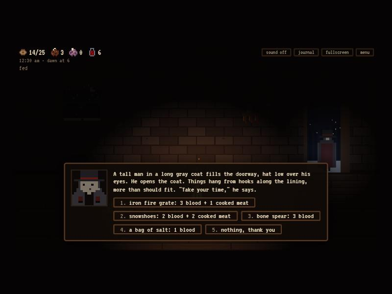

## Score

Only a night survived to dawn scores: for making it, how you lived through it, and **what you held on to**, which counts for a lot. A well-stocked cabin (say 25 logs, 15 cured meat, 15 blood and a woodshed) is worth 200, twice the dawn itself. On the score screen, **what you held on to** opens into each thing you kept and what it was worth.

| At dawn | Points |
| --- | --- |
| Made it to dawn | 100 |
| Each real person you let in | 10 |
| Each time you burned her back | 5 |
| The stranger still with you | 25 |
| What you held on to | 1 per log (pile and shed), 1 per raw meat, 3 per cooked meat, **5 per cured or smoked meat**, **4 per blood**, 2 per salt, 3 per fur, 5 per level of fire, and **40 for a woodshed**. After a blizzard night, **×1.25** |
| Each dawn after the first | +100, on top of the nights before |

The resource bar uses small pixel icons: a log end (with the pile's 25-log limit), then the meat in three counts, **cured** (dark and salt-flecked, which never goes bad; shown once you have some), **cooked** (which goes bad in a few minutes and over the day) and **raw**, then salt and a vial of blood. Hover an icon for its name. The room shows what you're keeping too: elk haunches hang from a meat rack (raw dark red and marbled, cooked seared brown, cured dark and salt-flecked, gray-green when about to turn), and below it a shelf holds corked vials of blood and a crock of salt.

Every death has its own few seconds before the red screen:

| Killed by | What you see |
| --- | --- |
| The dark | The last coal goes out. Eyes open one pair at a time all around the room. They blink together, and every time they open again they are closer, until one pair is right in front of you |
| Hunger | You slump sideways to the floor. Your vision blurs and narrows with each slower heartbeat, and a pair of red eyes waits at the edge of the light |
| The fire | Flames race out from the pit along the floor and climb the walls, smoke rolls down from the roof, and a burning beam comes down |
| The mimic | The door bangs open on what looks like a person. It unfolds, too tall for the doorway, its head bending down under the lintel on a broken neck and a mouth splitting down its face. Then it comes in, arms spread |
| Her, at the window | She pulls herself through the window, drops off the wall and comes across the floor toward you on her long arms |
| The thing in the trees | Its grin opens all the way and its eyes go red. A scream outside, something dragged past the window through the snow leaving a red smear, and then the door swings open in the wind and the fire sinks. Nobody comes home |
| The stranger, risen | Her body gets up in jerks, sitting, then standing, then taller than she was, and walks toward you |
| The thing under the floor | The hatch is thrown open, pale arms come up out of it and across the floor, and you're pulled down into the hole |
| The false stranger | In the dawn light her shadow climbs the wall, far too tall, red-eyed, its arms spreading across the ceiling, and bends down over you as the light goes out |
| The cold | A white glaze creeps in from the edges and frost ferns grow over it, your breath shows slower and fainter each time, and the fire seems to shrink away |
| The white (very rare) | About one blizzard night in a hundred, you lose the path for good. The whiteout swallows the room and a small dark figure walks away into it |

Every ending, death or dawn, shows a **recap of your night**: people let in, mimics kept out, times you burned her back, trips, meat cooked, how hungry you got and your **closest call**: the nearest you came to any of the threats you survived, such as the grin 92% full, burning her back with 0.4 s to spare, the dark 88% of the way in, slamming the hatch at the last moment or putting out the blaze with a second left. Whatever actually killed you doesn't count as a close call. It also shows an **all-time tally**, for example "14 nights · 2 dawns · killed by: the mimic 6, her, at the window 3, hunger 2". The tally also appears under best nights on the title screen. The simulation's automated nights don't count toward it.

The top-10 board takes three arcade initials. It's stored in the browser on that computer, like a single arcade cabinet; a shared online board would need a server, which was left out of scope.

| | |
| --- | --- |
| 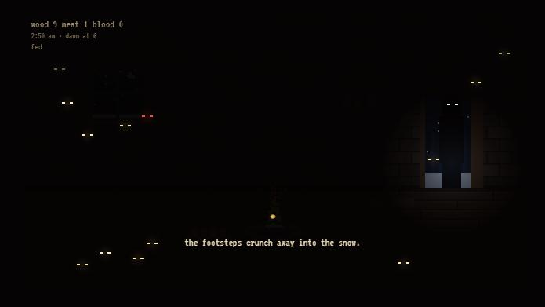 | 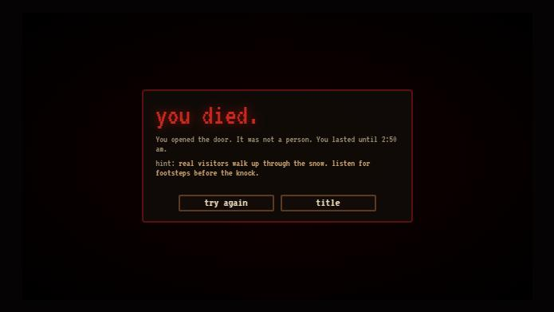 |
|  |  |

## Difficulty, tuned by simulation

[tools/sim.js](tools/sim.js) plays full nights at high speed through the game's test hook. Its players only use what a person could perceive: the footsteps, the lantern, the howl, the eyes in the treeline.

- **Beginner:** keeps the fire up and eats when hungry, but opens most doors, ignores the howling, reacts to the claws half the time, rarely builds and feeds the stranger whenever she asks.
- **Learner:** plays like a beginner, but follows each of the stranger's hints once it has heard it. This models a first-time player who reads.
- **Strong:** knows every tell. It boards up before 1 am, gets the lantern before the walkers, waits out the howling, burns the claws and feeds the stranger only on her last plea. It reacts a beat late, like a person, and misreads the footsteps now and then.
- **Skilled:** the same, but with instant, perfect reactions.

Results on 2026-10-17, after hunting was taken out (traps are the only meat at night; they cost 6 wood and catch less):

| Player | Nights | Survives | Main causes of death |
| --- | --- | --- | --- |
| Beginner | 100 | 0% | the trees 63%, mimic 17%, hunger 8% |
| Learner | 100 | 13% | hunger 51%, mimic 24%, her at the window 8% |
| Strong | 100 | 96% | her at the window 3% |
| Hoarder | 100 | 74% | mimic 20%, her at the window 6% |

The **hoarder** plays like the strong player but with the rush-traps-then-hoard plan: three traps at once, wood until midnight, then as few trips as possible. Before this round that plan let a good player coast through the rest of the night. It still survives less often than steady play (74% against 96%) and scores about the same: the pile caps at 25, meat spoils, traps wear out and hunger keeps you going out.

Night 2, among the runs that reach it (`sim.runTwo`):

| Player | Reached night 2 | Survives night 2 | Main causes of death |
| --- | --- | --- | --- |
| Learner | 45 of 200 | 9% | mimic 47%, the hatch while away 13% (measured before the economy round) |
| Strong | 48 of 60 | 63% | the hatch while away 15%, the dark 10%, her at the window 10% |

Two-night scores for the strong player now land between about 550 and 850. (Keeping a mimic out no longer scores, since letting one in kills you.)

A real first-time player lands between the beginner and the learner, so the large majority of first nights end in death. The doubled lantern cost is what brought the strong player down from about 93% to 84%: it now has to work to have the lantern lit when the walkers start.

The bots need some human sense to be realistic. Beginners sometimes run from a widening grin, and readers cook their meat after the first bout of sickness.

Tuning changes along the way:
- replaced the random death roll in the trees with the visible grin;
- added a grace period after a howl;
- made door visits more frequent;
- tightened wood and hunger;
- made the lantern burn blood every 60 seconds and doubled its cost;
- trimmed trap yields;
- had 60% of late mimics fake footsteps.

To rerun the simulation, open the game locally and run this in the browser console:

```js
const sim = await import('/tools/sim.js');
sim.report(120);
```

## How it's built

Plain HTML, CSS and JavaScript modules, with no framework, no build step and no dependencies.

- **Two-layer rendering.**
  - The room is drawn at 320×180 and scaled by a whole number, so pixels stay crisp squares.
  - A full-resolution light layer draws the darkness. It cuts soft holes for the fire, the blood lantern, the open door and dawn.
  - The eyes, her claws, the hunter's eyes and the red under the door are drawn on that layer, so they glow out of real darkness.
- **The night** is one state object advanced in fixed 50 ms steps. Each system is a small update function, gated by the hour:
  - the fire, hunger, spoilage and dread;
  - the hunter's cycle and trips;
  - the stranger's hunger and hints;
  - cooking and sickness;
  - the blood lantern's fuel;
  - her phases at the window (idle, warn, crawl or reach, then steal or retreat);
  - door scheduling.

  Dialogues pause the night, and the flames, snow and flicker drop to half speed so the pause is visible.
- **Her** is drawn at half-pixel detail on the light layer: black, with a dark-red rim, backlit by a red glow that also lifts the darkness enough to show the boards she's clawing at.
- **Sound** is generated with the Web Audio API, with no audio files:
  - fire crackle;
  - wind;
  - knocks and footsteps in snow;
  - the howl;
  - a board splintering;
  - the hiss of the burning branch;
  - glass shattering, and the rhythm of thuds as she works at the boards;
  - teeth chattering, retching, and meat sizzling on the fire;
  - a scream outside;
  - the heartbeat;
  - a death drone and a dawn chord.
- **Scoring and the leaderboard** are pure functions in [score.js](score.js), with Node unit tests. Stored entries are sanitized before use.

```
index.html          markup: canvases, HUD, actions, dialogue, panels, title and ending screens
style.css           pixel-styled UI, all sized from one --s scale variable
main.js             the night, threats, trips, doors, drawing, UI wiring
sound.js            procedural audio
score.js            scoring and leaderboard logic (pure, tested)
tests/              Node test runner tests
tools/sim.js        difficulty simulation (not deployed)
docs/               README screenshots
```

## Phones

The game runs in a phone browser, held sideways.

- **Fit:** the scene scales to fit the screen: whole-number scales when there's room, a fractional scale on small phones. It respects notches.
- **Touch:** on touch screens the buttons grow to about 40 px tall, the keyboard hints are hidden, and double-tap zoom and long-press menus are disabled.
- **Upright:** held upright, it shows a turn-sideways screen and the night waits.
- **Sound** unlocks on the first tap.
- **Fullscreen:** the button is hidden where the browser can't do it (iPhone Safari).
- **Performance:** the light layer is capped at 2× pixel density so the glow stays smooth on high-density screens.

## Run locally

```bash
python -m http.server 5350 --bind 127.0.0.1
```

Then open http://127.0.0.1:5350.

```bash
npm test
```

Pushes to `main` deploy to Vercel automatically.

## Verification

Checked on 2026-10-16:

- **The simulation runs above,** about 1,000 full nights across the three players during tuning.
- **Each threat triggered directly in a desktop browser preview,** using the test hook (`window.__firelight`). The rules behind them were checked the same way: the stranger-mimic text is identical to the real knock; she dies 22 s after an ignored third plea; feeding on the third plea lasts to dawn while feeding early needs a second meat; dragging her out sets the carcass effect; refusing the fleeing man raises dread, brings the hunter close and hurries the window; the lantern burns its blood and sputters out. Visually checked:
  - the hunter's eyes in the treeline;
  - her claws through the boards;
  - her crawling through a bare window, and the broken glass;
  - the stranger's plea;
  - the blood lantern's shadow under the door;
  - a trip, and running back;
  - the mimic death, with the figure in the doorway;
  - the death screen with cause and hint;
  - dawn, the score screen and initials.
- **9 unit tests pass,** with no console errors.
- **Screenshots** were staged with the test hook, so their numbers aren't from real play.

## Music

The background music is generated in the browser like the rest of the sound: a low, slowly breathing drone under a warped music box picking out a minor-key lullaby one note at a time, never quite in tune. As the night goes on, and as the dark closes in, a sour note creeps into the drone and the music box plays faster, with notes that clash. It's quieter during the day, and silent at dawn and when you die. **N** or the music button turns it off (remembered per browser).

## Achievements

30 achievements, under **achievements** on the title screen, with a toast and a chime when you earn one:
- **A death for every way to die**, 13 in all, including the very rare death lost in the white. Two are secret, shown as ??? with a hint until you find them.
- **Surviving nights 1, 2 and 3.** Nights 4 and 5 are listed for a later version.
- **Feats.** A few that mean something:
  - keeping her alive to the third dawn;
  - seeing through the false stranger;
  - counting the feet under the lantern;
  - turning away a walker;
  - burning her back with less than half a second to spare, or five times in a night;
  - dousing a blaze;
  - the bone spear;
  - filling the woodshed to all 100 logs;
  - holding 200 points' worth at one dawn;
  - a 1,000-point run.

They're stored in this browser for now (`achievements.js`). Each unlock keeps its time and a "not synced yet" flag, so a future account system can upload what you earned before you signed in. Simulated and playtest runs don't earn them.

## Playtesting

Open the game once with `?dev` on the address (https://firelight-topaz.vercel.app/?dev) and the title menu gets a **playtest** button, remembered in that browser. It starts you at the day before night 2 or 3, or straight into night 2 or 3, with a basic kit: boarded window, two traps (three on night 3), the lantern, the stranger, some food and wood, and on night 3 a woodshed and the drying rack. Playtest runs don't count toward the stats or the leaderboard.

The version is in the bottom-right corner (v0.36 is the 36th commit; the number counts every commit, docs included), so you can tell a refresh picked up the latest build.

## Future ideas

Noted for later and very much subject to change:
- **Night 4:** the blizzard again, with a new monster (concepts in `docs/spec-next-pass.md`), mimics that stand on two feet, and a slot in the door to see a visitor's face. A smoker for the stove.
- **Night 5:** a blood moon.
- **The stranger's story** and its endings.
- **The day overhaul:** trips that make sense in hours, a village worth exploring.
- **Accounts and a backend**, so scores, achievements and stats follow a player between devices.

## Known limits

- **Untested hardware:** never tested on a Chromebook or a touch device, and nobody has listened to the sound yet.
- **The simulated players are approximations.** Real players may find a threat harder or easier than the numbers suggest, especially the footsteps tell, which is text plus a sound.
- **Per-browser leaderboard.**
- **Phones are landscape only:** held upright, the game shows a "turn your phone sideways" screen and pauses. Checked in the browser's phone emulation at 375×812 upright and at 812×375 and 568×320 sideways, not on a physical phone.
- **School web filters** may block `vercel.app`.

## Credits

Inspired by *A Dark Room* by Michael Townsend / Doublespeak Games. No code, text or art was copied from it.

Built with heavy AI assistance (Claude Code) under Zach Shirley's direction:

- **Zach:**
  - **Concept and look:** chose the concept and the chunky pixel style with smooth firelight.
  - **Core horror elements:** the eyes in the dark, and visitors with dialogue.
  - **This redesign:** called out that the previous version had no stakes, and set:
    - the target that most players should die;
    - one short night that escalates;
    - wood-stockpile scoring;
    - the hand at the window that breaks boards and steals wood;
    - the blood lantern as an easier tell;
    - doors that never open by themselves;
    - a hunger mechanic and dangerous hunting trips;
    - no jump scares.
  - **The follow-up round:**
    - a stranger mimic indistinguishable except by knowing there's only one;
    - the stranger's hunger, the third plea, and the consequence of letting her starve;
    - her redesign as a black, red-glowing claw that shatters the glass and crawls in through a bare window, with the board-breaking rhythm;
    - more frequent, more dangerous doors, so the blood lantern and traps earn their place.
  - **The polish round:**
    - muting on the title screen and in background tabs;
    - a real hunger warning;
    - a costlier lantern and weaker traps;
    - raw and cooked meat with sickness, and icons;
    - the glass always breaking first;
    - the grin;
    - points for letting the right people in;
    - an eat cooldown;
    - a visible pause;
    - visitors waiting while you're out.
  - **The next round:**
    - cold instead of hunger, after Zach's mom pointed out nobody starves in one night;
    - the night recap and the all-time death tally;
    - the false stranger, who demands to be fed and kills you at dawn;
    - the grin tied to the creature's eyes instead of floating free.
  - **Day 2:**
    - the day screen and its choices;
    - salt;
    - nails;
    - tiredness;
    - the thing under the floor;
    - night 2's two-hour head start;
    - two-night scoring.

    Zach asked for a second day and left the design to Claude; the outline came from an earlier recommendation he had approved in principle.
  - **Her rebuild:** a scarier design with real animations for rising, grabbing, being burned, stealing and climbing in; the glass always breaking on her first visit; wind and cold through the broken window.
- **Claude Code:**
  - the mechanics design within that direction;
  - the code, art, sound and writing;
  - the simulation-based tuning and testing.

The font is [VT323](https://fonts.google.com/specimen/VT323) (SIL Open Font License).

## License

No open-source license has been chosen. The code is public to read, and all rights are reserved.
