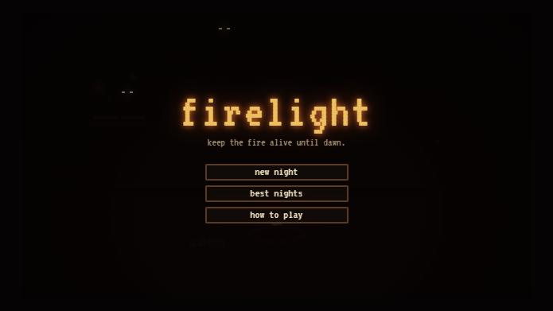
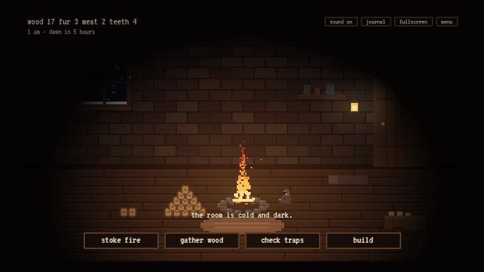
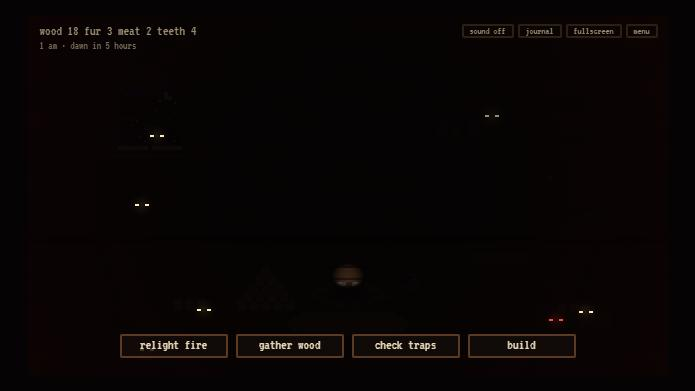
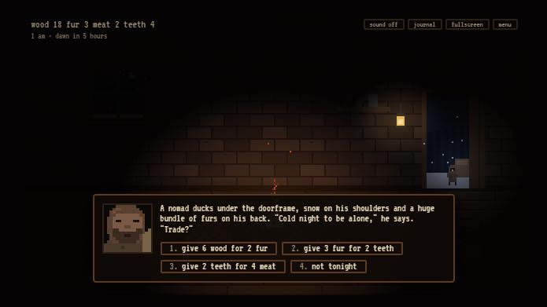
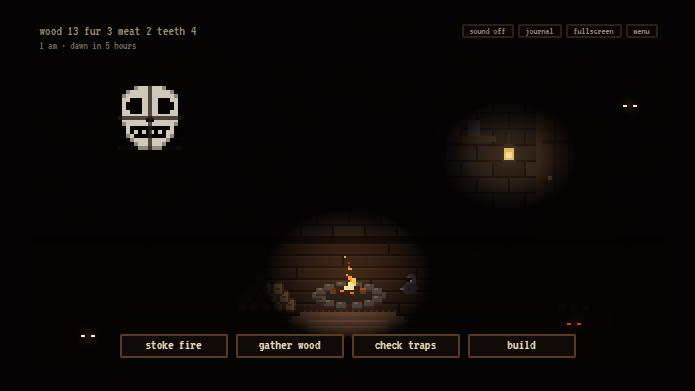
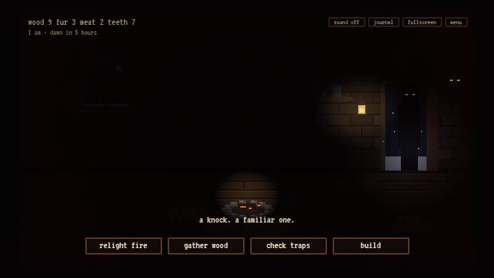
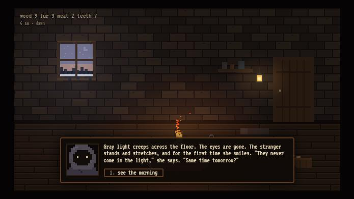
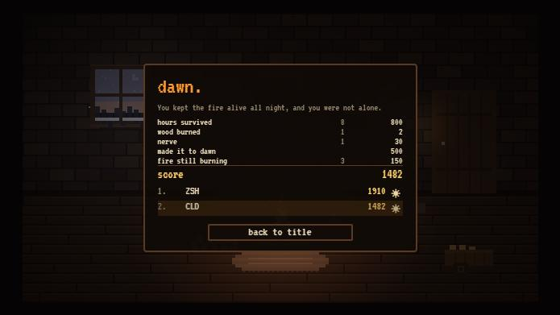

# Firelight

**Keep the fire alive in one dark room until dawn.**

A small survival game in chunky pixel art. The fire is the whole game. Keep it burning and the room stays warm and visible. Let it die and the dark fills with eyes. Strangers knock through the night, and not everything that knocks is a person.

**Play:** https://firelight-topaz.vercel.app (desktop browser, keyboard or mouse; one night takes about 20 minutes)



## How to play

| Key | Action |
| --- | --- |
| S | Stoke the fire (costs 1 wood) |
| G | Gather wood from the forest |
| T | Check traps |
| B | Build menu |
| J | Journal (message history) |
| 1–4 | Dialogue choices |
| M | Sound on/off |
| Esc / P | Menu (pauses) |

The night runs from 10 pm to 6 am. Each in-game hour is 2.5 minutes. **Survive until dawn.** The fire burns down one level at a time, a little faster every hour. If it stays out too long, *dread* builds: the eyes multiply and creep closer, a heartbeat starts, red closes in from the edges, and finally the door bursts open.



## What happens in a night

- **The stranger.** Once the fire has been going for a while, a ragged stranger knocks. Let her in and she sits by the fire, brings in wood, and offers to **build**. Shut her out twice and she's gone for good, and the dark gets more crowded.
- **Building** (materials come from gathering and traps):

  | Item | Effect |
  | --- | --- |
  | trap ×6 | Fur, meat and teeth |
  | cart | Double wood from gathering |
  | window boards | Nothing looks in, fewer gusts |
  | fur rug | Fire burns down slower |
  | lantern | A second pool of light the eyes won't enter |

- **Visitors** arrive about once a minute, sooner in the dark and later in the night:

  | Visitor | What happens |
  | --- | --- |
  | Nomad | Trades materials |
  | Woodcutter | Swaps meat or fur for a lot of wood |
  | Hungry kid | Asks for food. Feed them and they come back later with a gift |

- **Things in the dark:**

  | Thing | What happens |
  | --- | --- |
  | Tapping on the window | "Look" shows a face pressed to the glass |
  | Scratching at the door | Opening the door costs you your meat |
  | A voice at the door (from 1 am) | It sounds like the stranger, who is sitting right next to you. Opening the door costs wood and most of the fire |

- **The night gets harder.** From midnight, gusts knock the fire down. After 2 am the nearby forest thins out. The last hour burns hottest and hungriest.

| | |
| --- | --- |
|  |  |
|  |  |

## Endings and score

**Dawn:** survive all eight hours. The window turns pink-gray, the eyes withdraw, and the stranger (if she's with you) gets a last line.

**The dark came in:** dread reaches its limit. The door slams, the eyes rush the room, and the screen goes black.

| Score source | Points |
| --- | --- |
| Each hour survived | 100 |
| Each wood burned | 2 |
| Each thing built | 40 |
| Each trade | 15 |
| Letting the stranger in | 100 |
| Feeding the kid | 60 |
| Nerve (looking, or not opening the door to the voice) | 30 each |
| Reaching dawn | 500 |
| Each level of fire still burning at dawn | 50 |

The score screen offers a spot on the **top-10 "best nights" board** with three arcade initials.

**The board is local:** it's kept in the browser on that computer, like a high-score table on a single arcade cabinet. A shared online leaderboard would need a server and database, which was deliberately left out of scope.




## How it's built

Plain HTML, CSS and JavaScript modules: no framework, no build step, no dependencies. Any static host can serve the folder as-is.

- **Two-layer rendering.** The scene is drawn on a 320×180 canvas and scaled up by a whole number so each pixel stays a crisp square. A second canvas at full screen resolution draws the darkness and light:
  - it fills the screen with near-black;
  - it cuts soft elliptical holes for the fire, the lantern, the open door and dawn;
  - it adds warm and cool washes on top.

  Eyes, the window face and the dread vignette sit on that layer too, so they glow out of real darkness. The result is pixel-art objects under smooth, flickering light.
- **Flames** are particles that rise, taper toward the centre and cool through a five-colour palette. Spawn rate and width scale with the fire level.
- **Sound** is generated live with the Web Audio API; there are no audio files.
  - A filtered-noise roar and random crackles for the fire.
  - Gusting low-pass wind, louder in the dark.
  - Pitched-down sine thuds for knocks, the heartbeat and the door slam.
  - A detuned chord for the scare sting and a rising chord at dawn.
- **State** is one plain object saved to `localStorage` every few seconds, so a night can be closed and continued. The game has five modes: title, playing, dawn, lost and ended.
- **Scoring and the leaderboard** live in [score.js](score.js) as pure functions with unit tests. Stored leaderboard entries are sanitized before use.

```
index.html          markup: scene canvases, HUD, dialogue, panels, title and ending screens
style.css           layout and pixel-styled UI, all sized from one --s scale variable
main.js             game state, the night, events, drawing, UI wiring
sound.js            procedural audio
score.js            scoring and leaderboard logic (pure, tested)
tests/score.test.js Node test runner tests
docs/               screenshots for this README
```

## Run locally

```bash
python -m http.server 5350 --bind 127.0.0.1
```

Then open http://127.0.0.1:5350.

```bash
npm test
```

The tests use Node's built-in test runner and need no installs.

Pushes to `main` deploy automatically to Vercel.

## Verification

Checked on 2026-10-16 in a desktop browser preview. A test hook, `window.__firelight.step(seconds)`, fast-forwards game time.

- **A full night played by a simple script.** It stoked, gathered, checked traps, built, and answered every visitor. It reached dawn at exactly 8 in-game hours, with all seven hour messages, and met 19 visitors along the way, including three voices at the door. Then it went through the dawn scene, the score screen, and entering initials into the leaderboard.
- **A deliberate loss.** The fire was lit and then left dead. Dread built through its warnings and the door burst open after about 70 seconds, the eyes rushed the room, the screen went black, and the score screen showed the hour reached.
- **Each feature checked directly.** Each build item drawn in the room; the lantern repelling eyes; traps; each visitor's trades; the kid's gift loop; the window face; the scratch and voice-at-the-door outcomes; title screen continue and new night; mute persisting across reloads.
- **Unit tests.** 9 tests for scoring, ranking, ties, trimming, initials and malformed storage. No console errors.
- **Screenshots** were staged with the same test hook, so resource counts in them don't come from real play.

## Known limits

- **Untested hardware:** never tested on a Chromebook or a touch device, and the sound has never been listened to by a person.
- **Network-filtered school devices** may block the `vercel.app` domain.
- **Balance is tuned by reasoning, not playtesting:** an attentive player should usually reach dawn, and the score is where runs differ.
- **Per-browser leaderboard:** clearing site data wipes it.
- **No mobile layout:** it's sized for landscape desktop screens.

## Credits

Inspired by *A Dark Room* by Michael Townsend / Doublespeak Games. No code, text or art was copied from it. The scene, sprites, events and writing here are original.

Built with heavy AI assistance (Claude Code) under Zach Shirley's direction:

- **Zach:** chose the concept, the chunky pixel style with smooth firelight, eyes in the dark, visitors as characters with dialogue, the no-scrolling-log rule, the MVP scope, and later the title, night, ending, scoring and leaderboard round.
- **Claude Code:** wrote the code, art, sound and writing, and did the testing described above.

The font is [VT323](https://fonts.google.com/specimen/VT323) (SIL Open Font License).

## License

No open-source license has been chosen. The code is public to read, and all rights are reserved.
